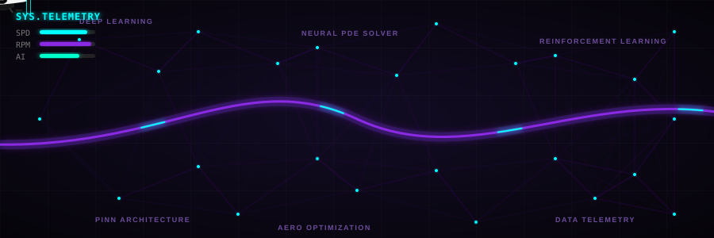
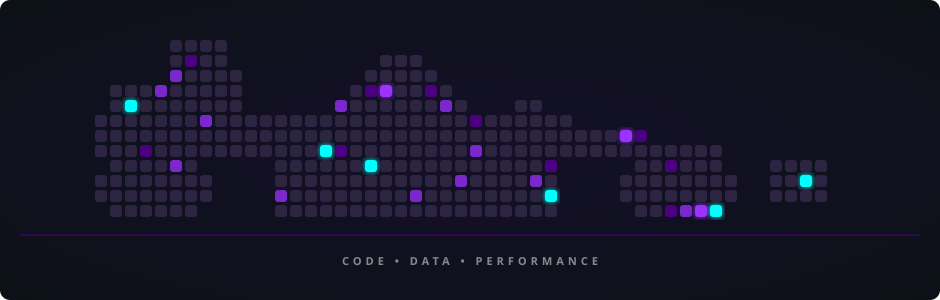

<div align="center">

# D. Devanandu

<a href="https://git.io/typing-svg">
  
</a>

<p align="center">
  <em>Building intelligent systems at the intersection of AI, scientific computing and real-world engineering.</em>
</p>

<!-- Badges -->
<p align="center">
  
  
  
</p>

<!-- Connect -->
<p align="center">
  <a href="https://github.com/Devadn11206"></a>
  <a href="mailto:ddevanandu003@gmail.com"></a>
  <a href="https://www.linkedin.com/in/ddevanandu003/"></a>
  <a href="https://doi.org/10.1016/j.chaos.2026.119133"></a>
</p>

<!-- Profile Stats Badges -->
<p align="center">
  
  
  
</p>

</div>

---

<p align="center">
  
</p>

## 👨‍💻 About Me

I am an **Artificial Intelligence & Machine Learning** undergraduate (B.E. CSE AI & ML, 2024–2028, CGPA: 8.22 at Chennai Institute of Technology) and **published researcher** (Elsevier Q1, *Chaos, Solitons & Fractals*) passionate about engineering high-impact, production-grade AI systems and advancing scientific machine learning.

- 💼 **Current Role:** AI/ML Intern at **Quapt Technologies Pvt Ltd** (Oct 2026 – Present), building enterprise OCR + LLM structured document extraction pipelines with strict Pydantic schema validation.
- 🔬 **Research Role:** Research Intern at **IIIT Sri City** (Apr 2026 – Present), developing Multi-Agent Reinforcement Learning (CoLight, PressLight, IDQN) + Physics-Informed Neural Networks (PINNs) for intelligent smart city traffic signal control.
- 📚 **Academic Research:** Published co-author in *Chaos, Solitons & Fractals* (Elsevier, Q1, Vol. 212, Article 119133, 2026) on PINNs for nonlinear Schrödinger equations, with an additional paper currently under review at Springer Nature.
- 🎯 **Availability:** Seeking AI/ML engineering internships, available immediately through February 2027.

---

<!-- Animated Research Identity Strip -->
<div align="center">
  <a href="#">
    
  </a>
</div>

---

## ⚡ What I Build

<div align="center">
  <table>
    <tr>
      <td align="center" width="33%">
        <b>✨ Generative AI & GraphRAG</b><br/>
        Multi-tenant RAG systems, Reciprocal Rank Fusion, cross-encoders, and knowledge graphs.
      </td>
      <td align="center" width="33%">
        <b>🔬 Scientific AI & PINNs</b><br/>
        Physics-Informed Neural Networks for nonlinear PDEs, soliton dynamics, and flow constraints.
      </td>
      <td align="center" width="33%">
        <b>🔒 Federated & Private ML</b><br/>
        Multi-institution medical AI with Flower, ConvNeXt, FedBN, and Opacus Differential Privacy.
      </td>
    </tr>
    <tr>
      <td align="center" width="33%">
        <b>🤖 Multi-Agent AI Systems</b><br/>
        LangGraph stateful workflows, autonomous ML pipelines, tool calling, and self-correction.
      </td>
      <td align="center" width="33%">
        <b>🚦 Multi-Agent RL</b><br/>
        Adaptive traffic network control using SUMO, TraCI, CoLight, PressLight, and IDQN.
      </td>
      <td align="center" width="33%">
        <b>⚙️ Production MLOps</b><br/>
        FastAPI microservices, Docker containerization, Redis caching, telemetry, and strict test suites.
      </td>
    </tr>
  </table>
</div>

---

## 🛠️ Tech Stack

<h3 align="center">Languages & Core</h3>
<p align="center">
  
  
  
  
  
</p>

<h3 align="center">Machine Learning & Deep Learning</h3>
<p align="center">
  
  
  
  
</p>

<h3 align="center">Generative AI, Agents & RAG</h3>
<p align="center">
  
  
  
  
  
  
</p>

<h3 align="center">Federated Learning & Privacy</h3>
<p align="center">
  
  
  
</p>

<h3 align="center">Scientific ML, PINNs & Reinforcement Learning</h3>
<p align="center">
  
  
  
  
</p>

<h3 align="center">Backend, MLOps & Production Tools</h3>
<p align="center">
  
  
  
  
  
  
  
</p>

---

## 📊 AI / ML Competency Matrix

| Domain | Proficiency | Technologies & Methodologies |
| :--- | :--- | :--- |
| **Generative AI & LLM Systems** | Advanced | RAG, GraphRAG, Hybrid Retrieval (RRF), Cross-Encoder Reranking, LLM Routing, Pydantic |
| **Agentic AI & Orchestration** | Advanced | LangGraph Stateful Graphs, Tool Execution, Self-Correction, Multi-Agent Collaboration |
| **Federated Learning & Privacy** | Advanced | Flower FL, ConvNeXt-Tiny, FedBN, FedProto, Opacus Differential Privacy ($\varepsilon=7.82$), Byzantine Defense |
| **Scientific ML & PINNs** | Advanced | DeepXDE, PyTorch, Neural PDE Solvers, Nonlinear Schrödinger Dynamics, Adam + L-BFGS |
| **Multi-Agent Reinforcement Learning** | Advanced | SUMO, TraCI, CoLight, PressLight, IDQN, Physics-Constrained Signal Optimization |
| **Production Engineering & MLOps** | Advanced | FastAPI, PostgreSQL, Redis, Docker, PyTest, DICOM Processing, SHA-256 Audit Ledgers |

---

## 🔬 Publications & Research Lab

<div align="center">
  
  <a href="https://doi.org/10.1016/j.chaos.2026.119133"></a>
  
</div>

<br/>

### 📄 Published Journal Paper:
> **“Analysis of nonlinear Schrödinger equations with anticubic nonlinearity in optical fiber systems via physics informed neural network (PINN)”**  
> *Chaos, Solitons & Fractals* (Elsevier, **Q1 Journal**), Vol. 212, Article 119133, 2026.  
> **Authors:** A. Muniyappan, **D. Devanandu** *(Second Author)*, M. Mubeen Tajudeen, Nasser-eddine Tatar, Adnène Arbi.  
> **Direct Link:** [](https://doi.org/10.1016/j.chaos.2026.119133)  
> **Core Contribution:** Lead software implementation (PINN in DeepXDE & PyTorch), empirical investigation (numerical experiments, error, stability, and convergence analysis), and manuscript drafting.

### 📄 Papers Under Review:
> **1 Paper Under Review at Springer Nature:** Investigating Physics-Informed Neural Networks, scientific machine learning, and nonlinear dynamical systems.

---

## 🚀 Flagship Projects

<details open>
<summary><b>1. 🧠 RAGX: Production-Oriented Multi-Tenant RAG Platform</b></summary>
<br/>

- **Description:** Enterprise-ready multi-tenant Retrieval-Augmented Generation platform built with document ingestion, hybrid vector + lexical retrieval, and knowledge-graph routing.
- **Key Highlights:**
  - **Hybrid Search & GraphRAG:** Fuses vector and BM25 search via Reciprocal Rank Fusion (RRF), refined through cross-encoder reranking and MMR. Achieved **71.5% Exact Match** with GraphRAG (vs 48.2% baseline vector search) at **76.5 F1** and **0.86 nDCG**.
  - **Citation & Fallback:** Citation-aware generation with LLM routing and automatic fallback (Gemini & Groq), backed by semantic caching.
  - **Strict Security:** Enforced robust multi-tenant data isolation — **11/11 security tests passed** with 0 leaks, and **47/47 regression tests passing**.
- **Tech Stack:** Python, FastAPI, PostgreSQL, Redis, Docker, Streamlit, Gemini, Groq, PyTest.
</details>

<details open>
<summary><b>2. 🏥 FedMedVision: Privacy-Preserving & Explainable Federated Medical AI</b></summary>
<br/>

- **Description:** Federated Learning healthcare platform training vision models across hospital silos without centralizing sensitive patient clinical data.
- **Key Highlights:**
  - **Multi-Hospital FL:** 6-hospital simulated federated learning system using **ConvNeXt-Tiny + FedBN + FedProto** across **20,000+ chest X-rays** (NIH ChestX-ray14, CheXpert, VinDr-CXR), yielding an **11% AUROC boost** over isolated institutions.
  - **Differential Privacy & Byzantine Defense:** Differential Privacy via **Opacus ($\varepsilon = 7.82$)**, Trimmed-Mean Byzantine aggregation against poisoning attacks, and an immutable SHA-256 EU AI Act compliance audit ledger.
  - **Clinical Interface:** Streamlit radiology dashboard featuring full DICOM windowing, Grad-CAM++ lesion localization verified against radiologist bounding boxes, and automated PDF clinical reporting (**76/76 unit & integration tests passing**).
- **Tech Stack:** PyTorch, Flower (FL), Opacus, ConvNeXt-Tiny, Streamlit, PyDicom, ReportLab, PyTest.
</details>

<details open>
<summary><b>3. 🤖 MLForge: Multi-Agent Autonomous ML Engineering Platform</b></summary>
<br/>

- **Description:** Autonomous multi-agent engineering platform that converts natural-language problem specifications into end-to-end production ML pipelines.
- **Key Highlights:**
  - **LangGraph Multi-Agent Architecture:** Specialized cooperating agents handle planning, dataset EDA, feature engineering, model selection, hyperparameter tuning, evaluation, and debugging.
  - **Self-Correction Loops:** Agents interpret test failures and poor validation metrics to iteratively debug and refine pipelines autonomously.
  - **Microservice Design:** FastAPI backend, PostgreSQL persistence, and Pydantic schemas, containerized with Docker.
- **Tech Stack:** LangGraph, Python, FastAPI, PostgreSQL, Docker, Scikit-learn, XGBoost, Pydantic.  
[View Repository](https://github.com/Devadn11206/MULTI_AI_AGENTS)
</details>

<details open>
<summary><b>4. 🚦 Smart City Traffic Signal Control using MARL & PINNs</b></summary>
<br/>

- **Description:** Distributed multi-agent traffic signal control incorporating physics-based flow dynamics to alleviate city grid congestion.
- **Key Highlights:**
  - **Multi-Agent RL Benchmarks:** Implemented and benchmarked **CoLight, PressLight, and IDQN** agents in SUMO and TraCI across multiple real-world traffic network topologies.
  - **Physics-Informed Flow Integration:** Coupled PINNs with deep RL to predict future traffic density and enforce continuity/physical constraints, achieving substantial reductions in delay, queue length, and travel time.
  - **Emergency Prioritization:** Active emergency vehicle prioritization algorithms and dynamic route clearance.
- **Tech Stack:** SUMO, TraCI, Python, PyTorch, Gymnasium, CoLight, PressLight.  
[View Repository](https://github.com/Devadn11206/Smart-City-AI-Traffic-Management-System-)
</details>

<details>
<summary><b>5. 🔬 Scientific ML: Physics-Informed Neural Networks for Nonlinear PDEs</b></summary>
<br/>

- **Description:** Deep learning frameworks solving complex nonlinear wave and Schrödinger-type equations under diverse initial and boundary conditions.
- **Key Highlights:**
  - Developed custom PINN architectures in DeepXDE and PyTorch with hybrid Adam + L-BFGS optimization routines.
  - Conducted rigorous convergence, stability, and conserved-quantity error analyses across high-order nonlinearities.
- **Tech Stack:** DeepXDE, PyTorch, SciPy, Matplotlib.
</details>

<details>
<summary><b>6. 🔋 AI-Powered Electric Vehicle System & RAG Assistant</b></summary>
<br/>

- **Description:** Developed for Edunet Foundation × Shell Foundation, combining predictive EV modeling with conversational intelligence.
- **Tech Stack:** Python, Scikit-learn, LangChain, RAG, Streamlit.  
[View Repository](https://github.com/Devadn11206/ev_vehicle)
</details>

---

## 💼 Experience & Research Roles

```
[Oct 2026 – Present] AI/ML Intern | Quapt Technologies Pvt Ltd
└── Document extraction pipelines (OCR + LLM) converting raw documents into validated data.
└── Engineered structured Pydantic schemas, field validation rules, and error mitigation.
└── Continuous evaluation on field-level precision, recall, and layout variation.

[Apr 2026 – Present] Research Intern | IIIT Sri City
└── Smart city traffic signal control combining SUMO, TraCI, PINNs, and Multi-Agent RL.
└── Implemented CoLight, PressLight, and IDQN agents; benchmarked queue lengths and network efficiency.
└── Coupled physical flow conservation constraints (PINNs) into reinforcement learning policies.

[Nov 2025 – Dec 2025] AI & Machine Learning Intern | Edunet Foundation – Shell Foundation
└── Developed machine learning pipelines for Electric Vehicle infrastructure analytics.
└── Created RAG-based domain chatbot for intelligent sustainability insights.
```

---

## 🏆 Honors, Awards & Certifications

- **Q1 Journal Publication:** Published in *Chaos, Solitons & Fractals* (Elsevier, Vol. 212, Article 119133, 2026).
- **Hackathon Finalist:**
  - CSI Origin '26
  - India AI Impact Buildathon 2026 (GUVI × HCL)
  - DeveloperWeek New York 2026
  - HackFest '26
- **Professional Certifications:**
  - **AWS Cloud Practitioner** — Simplilearn
  - **Introduction to Modern AI** — Cisco
  - **Data Analytics with Python** — NPTEL
  - **Introduction to Data Science** — Infosys Springboard
  - **Web Development Essentials** — IBM

---

## 📊 GitHub Analytics

<div align="center">
  
  
</div>

<div align="center">
  
</div>

<br/>

## 🏎️ Contribution Drive

<p align="center">
  
</p>

---

<div align="center">
  <sub>Engineered with precision • Themed in <b>Sage</b>, <b>Off-White</b>, <b>Tomato Red</b>, <b>Electric Blue</b>, & <b>Acid Lime</b></sub>
</div>
